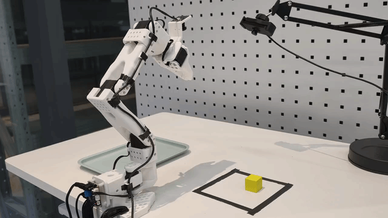

# SO-ARM101 × π₀.₅：全参数微调与真机闭环部署

基于 LeRobot 的 π₀.₅ VLA 模型，在 SO-ARM101 主从机械臂平台上完成黄色方块抓取放置任务。项目覆盖双视角示范采集、基础/纠错/策略运行后补充数据的分阶段训练，以及云端推理与本地动作执行的 RTC 集成。

测试中改变方块位置，并观察到策略自主纠错。

模型权重：[the42thnut/pi05-so101-cube-dagger](https://huggingface.co/the42thnut/pi05-so101-cube-dagger)。仓库整理实际运行文件。

## 真机演示



完整25次抓取（包含自主调节和全部方位）：https://www.bilibili.com/video/BV1zznd61EZF/?share_source=copy_web&vd_source=059f647dfdb9f59309fe00d5e8117d88

## 项目工作与实现边界

- **真机数据闭环**：使用主从臂遥操作采集基础示范，针对抓取偏差、空抓等失败状态补充纠错示范，再结合策略运行暴露的问题采集 DAgger 阶段数据。
- **全参数微调**：在单张 A800 80GB 上训练，不冻结视觉编码器或其他模型部分；采用 BF16 和梯度累积。
- **远程部署与诊断**：集成已有 RTC 实现与动作队列机制，连接云端动作预测和本地执行，处理推理期间已消耗动作的裁剪、过期响应、队列耗尽和静止重建，并记录请求延迟、关节跟踪误差与动作切换差异。
- **评测与实验**：完成 50 次真机任务测试，保留训练日志和编译性能实验。

## 任务与模型接口

| 项目 | 设置 |
|---|---|
| 任务 | 将黑色框选区域内的黄色方块抓取并放入灰蓝色托盘 |
| 观测 | 第三视角 front + 腕部 wrist RGB、语言指令、6 维关节状态 |
| 原始图像 | 两路 640 × 480，30 FPS；模型配置图像分辨率 224 × 224 |
| 状态/动作维度 | 6：shoulder_pan、shoulder_lift、elbow_flex、wrist_flex、wrist_roll、gripper |
| 动作形式 | 绝对关节位置目标；6 维包含夹爪 |
| 动作块 | 50 × 6；配置 Flow 推理步数为 10 |
| 本地执行 | 目标 30 Hz |

## 数据与训练路线

完整合并数据集为 **108 episodes / 63,791 frames**，其中 **101 条训练示范 / 59,403 frames**，另有 **7 条保留数据 / 4,388 frames**。

| 数据组 | 总 episodes | 训练 episodes | 训练 frames | 采样比例 |
|---|---:|---:|---:|---:|
| 基础示范 base | 50 | 45 | 28,083 | 30% |
| 纠错示范 recovery | 38 | 38 | 17,760 | 30% |
| 策略运行后补充 dagger | 20 | 18 | 13,560 | 40% |
| 合计 | 108 | 101 | 59,403 | 100% |

数量与 episode 映射见 [reference_split.json](dagger_training_delivery/reference_split.json)。训练数据统一为 30 Hz；数据处理与重采样入口见下方文件导航。

训练沿同一权重链分阶段推进：基础阶段 2000 步 → 在基础权重上继续 recovery 阶段 2000 步 → 在 recovery 002000 权重上继续 DAgger 阶段 4000 步。后续阶段调整数据和超参数。

**训练结束权重与部署选择分开记录：** DAgger 训练完成至 004000。

## DAgger 阶段训练设置

| 项目 | 值 |
|---|---|
| 初始化 | recovery 阶段 `002000/pretrained_model` |
| 本轮更新 | 4000 |
| 单卡 micro batch / 梯度累积 | 8 / 32，有效 batch 256 |
| 精度 | BF16，全量微调；gradient checkpointing 关闭 |
| 学习率 | 100 步线性 warmup，之后余弦衰减；峰值 1e-5，末值 1e-6 |
| 优化器 | AdamW，weight decay 0.01，梯度裁剪 1.0 |
| 数据 | 108 episodes、63791 frames、30 Hz |
| 划分 | 101 train / 7 held-out；59403 / 4388 frames |
| 有放回采样 | base / recovery / dagger = 30% / 30% / 40% |
| 本轮耗时 | 23:20:11（训练进度条记录） |
| 最后记录 loss | 0.0020313，仅训练 loss，不代表任务成功率 |

采样每个 update 有整数取整，五个 update 合计精确满足 3:3:4。保留集 episode 为 0、17、26、34、44、88、106；本包未提供其独立评测结果。配置名 `pi05_wsd` 是兼容标识，实际实现为余弦调度。日志的 `cumulative_update=8000` 来自脚本固定加 4000。

## 文件导航

- `dagger_training_delivery/`：本轮训练器、启动器、原生训练源码参考、划分及 CPU 测试。
- `pi05_full_training/`：先前基础和 recovery 训练版本，保留为训练溯源。
- `data_preparation/`、`code/rebuild_dagger_30hz.py`：数据检查和重采样。
- 根目录 `pi05_async_diag_client.py`、`pi05_rtc_server.py`、`run_rtc_server.sh`：当前异步诊断客户端与服务端入口。
- `logs_client/`：真机客户端 JSONL 运行日志。
- `rtc_compiled_delivery/`：支持 eager / compiled 的服务端，默认 eager。
- `rtc_package/`：客户端、动作队列、mock 测试及早期服务端。
- 根目录 `*benchmark*.py`、`logs/*benchmark*.json`：性能实验代码与原始结果。
- `configs/final_checkpoint/`：最终 checkpoint 的四份 JSON；推理还需 HF 上的权重和 processor safetensors。
- `results/training_metrics.csv`、`results/training_summary.json`：从日志提取的 402 条记录。

原始子目录 README 保留作历史记录；当前状态和实验结论以本 README 与原始结果为准。

## 环境与复现边界

训练器明确要求 **LeRobot 0.6.1**。
代码还使用 PyTorch、TorchCodec、Transformers、Accelerate、NumPy、Pillow 及 LeRobot 的机器人/相机依赖。

启动脚本保留原 AutoDL 的路径和动态库设置。换机器必须调整环境路径、缓存目录、数据目录和相机设备。


## RTC 推理与本地执行

本地采集两路图像和关节状态，异步提交云端推理请求；等待期间继续执行动作队列。服务端利用剩余动作前缀进行 RTC 引导，客户端按请求期间实际消耗的动作步数裁剪返回动作，避免重复执行旧时间片。

遇到超时、旧时间线响应或队列耗尽时，客户端保持当前位置、丢弃旧计划，再从新观测重建动作块。

```

本地通过 SSH 将服务器 8088 端口转发到 18088 后，先验证只读链路：

```bash
python pi05_async_diag_client.py --dry-run --seconds 60
```

核对串口、校准 ID、两路相机设备与起始姿态后，启用真机动作：

```bash
python pi05_async_diag_client.py --live --seconds 60
```

客户端默认 30 Hz、`request-after=1`、`initial-delay=12`，以实际日志中的参数为准。服务端启动脚本仍包含原 AutoDL 环境路径，迁移前需调整；更换 checkpoint 时需同步检查客户端的权重路径校验。

## 真机结果

| 指标 | 当前记录 |
|---|---|
| 测试任务 | 黄色方块抓取并放入托盘 |
| 测试次数 | 50 |
| 成功 / 失败 | 47 / 3 |
| 成功率 | **94%** |
| 测试变化 | 改变方块位置 |
| 定性观察 | 出现自主纠错行为，尚未单独统计纠错成功率 |


## 编译实验：速度与一致性分别报告

`logs/rtc_compile_benchmark_20261023_135706.json` 在旧 recovery checkpoint 上记录：eager 中位数 322.98 ms，compiled 146.42 ms，约 2.21×。但同时 `parity_passed=false`、`integration_candidate=false`。


`results/training_summary.json` 中的 `real_robot_evaluation: pending` 是训练结束时的历史快照，不代表后续没有进行真机测试；其中 004000 的训练指标也不应与 003500 的部署记录混用。

上游项目：[Hugging Face LeRobot](https://github.com/huggingface/lerobot)、[Physical Intelligence OpenPI](https://github.com/Physical-Intelligence/openpi)。本项目是基于上游模型与 RTC 实现的数据、训练和真机部署实践。
